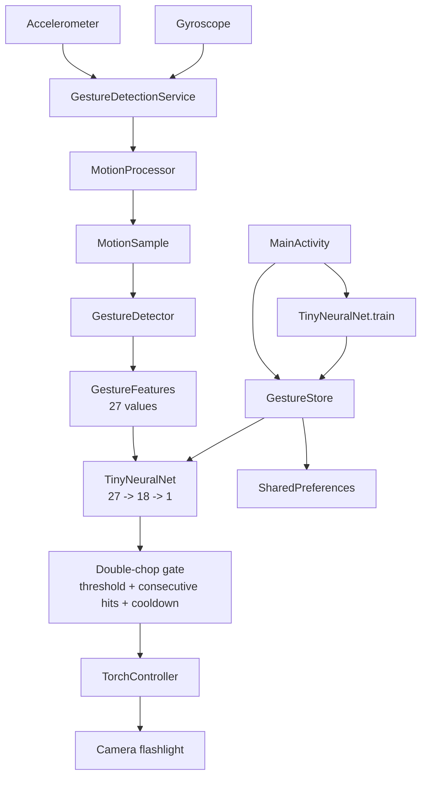

# ChopTorch system design

## 1. Purpose and scope

ChopTorch turns a short, user-defined double-chop motion into a flashlight toggle. It runs the recognition pipeline on the device so raw motion data does not need to leave the phone. Development builds additionally let the user label motion examples, train a small model, and flag false positives.

The system supports two operating modes:

- **Development mode:** training, feedback, model export, and bundled seed examples are available.
- **Shipping mode:** a current model is bundled in the APK; training, feedback, and export are disabled.

The product is intentionally narrow: it recognizes one gesture and controls one device capability. It does not provide a general gesture framework or cloud inference service.

## 2. Architecture



### Responsibilities

| Component | Responsibility |
| --- | --- |
| `MainActivity` | User controls, permissions, training, labeling, feedback, and manual torch toggle. |
| `GestureDetectionService` | Foreground sensor subscription, continuous processing, notification actions, and service lifetime. |
| `MotionProcessor` | Aligns accelerometer and gyroscope data, estimates roll/pitch, and reconstructs linear acceleration. |
| `MotionSample` | Immutable-ish handoff of timestamped sensor and fused-angle data. |
| `GestureDetector` | Maintains the streaming window, schedules predictions, applies gesture gates, and reports detections. |
| `GestureFeatures` | Converts a motion window into the model's versioned 27-value input vector. |
| `TinyNeuralNet` | Runs inference and supervised training for the compact on-device classifier. |
| `GestureStore` | Persists examples, models, and feedback metadata in `SharedPreferences`. |
| `TorchController` | Uses Camera2 to query and toggle the flashlight and report state. |
| `AngleKalman` | Filters roll and pitch while compensating for gyro bias and unreliable acceleration. |
| `RecoveredExampleDeduper` | Repairs the known duplicate-seed recovery case without deleting user recordings. |

## 3. Runtime data flow

1. The foreground service registers the accelerometer and gyroscope at the app's sensor rate, targeting roughly 50 Hz.
2. Each sensor event is passed through `MotionProcessor`, which fuses the streams and emits a `MotionSample`.
3. `GestureDetector` keeps approximately 1,900 ms of recent samples and evaluates the window every 160 ms.
4. `GestureFeatures` extracts 27 normalized/statistical motion features.
5. `TinyNeuralNet` returns a probability in `[0, 1]`.
6. The detector accepts a result only when the configured threshold, double-chop shape, consecutive-hit, and cooldown gates pass.
7. `TorchController` toggles the flashlight. The triggering feature vector and score are retained for the feedback window.

## 4. Detection contract

The current detector defaults are:

- Window: 1,900 ms.
- Prediction interval: 160 ms.
- Probability threshold: 0.82.
- Consecutive positive predictions: 2.
- Accepted-detection cooldown: 1,600 ms.
- Double-chop peak gap: 190-1,100 ms.

The detector is designed as a pure-Java component so feature extraction and inference can be tested without an Android device. See [Gesture detection](features/gesture-detection.md) for the complete behavioral contract.

## 5. Android lifecycle and permissions

`MainActivity` starts monitoring after the required runtime permission flow succeeds. The service is not stopped when the activity pauses or is destroyed, so recognition can continue with the display off. The service runs as a special-use foreground service, displays a persistent notification, and holds a partial wake lock while active.

Manifest capabilities:

- `CAMERA` for flashlight control.
- `FOREGROUND_SERVICE` and `FOREGROUND_SERVICE_SPECIAL_USE` for continuous monitoring.
- `POST_NOTIFICATIONS` for the service notification.
- `WAKE_LOCK` for display-off sensor processing.

The camera flash and sensor hardware are optional manifest features. A device without them cannot provide the complete experience, and the UI/service should treat those capabilities as unavailable rather than assuming they exist.

## 6. Persistence and versioning

`GestureStore` uses `SharedPreferences` keys with explicit version suffixes:

- `examples_v1`: labeled examples containing a boolean label and a 27-value feature vector.
- `model_v1`: serialized neural-network parameters and detection configuration.
- `last_on_detection_v2`: the last accepted detection's features, score, and timestamp.
- `feedback_message_v2`: user-facing feedback status.

A loaded model is usable only when its model version, feature version, feature count, hidden-layer size, and parameter shapes are compatible with the current runtime. There is currently rejection rather than migration for incompatible model layouts.

## 7. Build variants

The project targets Java 17, compile SDK 36, target SDK 35, and minimum SDK 26. The `ENABLE_TRAINING` build configuration controls development-only behavior.

- Development application ID: `com.example.choptorch.devclassic`.
- Shipping application ID: `com.barbarioli1.choptorch`.
- Shipping builds require a trained model in `app/src/main/assets/choptorch_model.json`.

A development model can be exported, copied into the shipping asset, and packaged with training disabled. Distinct development IDs protect data from older installed development variants.

## 8. Design decisions

### On-device inference

The model is small enough for immediate inference and training on the phone. This avoids network latency and keeps motion data local.

### Shape gate before actuation

The classifier is not the only authority for turning on the torch. A valid double-peak shape is required in addition to the model score, reducing accidental activation from a single energetic movement.

### Consecutive hits and cooldown

Two positive evaluations reduce one-sample noise. The 1,600 ms cooldown prevents repeated toggles while a single movement is still represented in the sliding window.

### Foreground service for continuity

Monitoring is explicitly user-started and visible through a persistent notification. This makes the battery and background-execution cost discoverable while allowing the gesture to work when the app is not in the foreground.

## 9. Reliability boundaries and known gaps

- Sensor delivery, timing, power-saving policies, and device hardware affect recognition latency and accuracy.
- The partial wake lock can consume significant battery.
- Incomplete training recordings are not crash-safe until labeled and saved.
- User data remains in `SharedPreferences`; there is no dedicated export/import workflow for examples.
- The model schema has no migration path.
- `StreamingDetectorTest` is present but currently targets a non-existent `onSample()` API and is not included in `tests/run-core-tests.sh`.
- There are no Android instrumentation tests for service lifecycle, permissions, Camera2 torch behavior, or real sensor streams.

## 10. Verification strategy

The current low-cost verification path is:

```bash
bash tests/run-core-tests.sh
```

Future coverage should add a direct streaming detector test against the current public API, model compatibility tests for malformed JSON, and device/instrumentation checks for service startup, notification actions, wake-lock release, permission denial, and torch failures.
