# Publish ChopTorch to Google Play: step-by-step tutorial

This tutorial walks you through publishing ChopTorch from zero. It follows the [Google Play shipping checklist](google-play-shipping-checklist.md), so tick items there as you finish each part.

Each step has three parts: **What** you do, **Why** it matters, and **Check** that it worked.

Google Play Console menus and rules change. Where this tutorial says "verify", read the current text in Play Console before you act.

## The big picture

```mermaid
flowchart LR
    A[1. Prepare the code] --> B[2. Create upload key]
    B --> C[3. Create the app in Play Console]
    C --> D[4. Set up GitHub and Google Cloud]
    D --> E[5. Upload to internal testing]
    E --> F[6. Test from the Play Store]
    F --> G[7. Fill in store listing and forms]
    G --> H[8. Closed testing if required]
    H --> I[9. Production, staged rollout]
    I --> J[10. Monitor]
```



Two ideas help everything else make sense:

- **Upload key vs app signing key.** You sign your bundle with an *upload key* that you keep. Google re-signs the app that users download with its own *app signing key* (Play App Signing). If you lose the upload key, Google can reset it. If you lose a key you used to sign APKs yourself, you cannot update the app.
- **Tracks.** Play has stages: **Internal testing** (fast, up to 100 testers), **Closed testing**, **Open testing**, and **Production**. This project's workflow uploads only to the internal track. You promote to production in Play Console.

## Before you start

You need:

- A Google account for the Play developer account.
- A GitHub account with access to `barbarioli1/ChopTorch` (already the repository's remote, branch `main`).
- A Google Cloud project (free to create) for publishing automation.
- JDK 17 (already installed locally; `keytool` ships with it).
- About an hour of your own time spread across the steps, plus waiting for Google's review and verification.

You do **not** need a paid ASO tool. See section 7 of the checklist for listing keywords.

---

## Part 1. Prepare the code

### Step 1.1: Make sure the tests still pass

**What:** From the repo root in PowerShell, run:

```powershell
bash tests/run-core-tests.sh
.\gradlew.bat lintDebug
.\scripts\device-test.ps1 -Serial <your-serial> -Variant shipping
```

Get your serial from `adb devices -l`. Use the Android SDK `platform-tools` path if `adb` is not on `PATH`.

**Why:** You want a known-good build before you start, so any later failure points to the new step you just did.

**Check:** Core tests print `PASS`, lint finishes with `BUILD SUCCESSFUL`, and the device test ends with `Device test exit code: 0`.

### Step 1.2: Commit the files the CI build needs

**What:** The publishing workflow builds from what is on GitHub, not from your folder. Right now `gradle/wrapper/gradle-wrapper.jar` is **untracked**, so the workflow would fail. Review and commit your changes:

```powershell
git status --short
git add -A
git status --short
```

Read the second list before committing. Make sure it contains these and does **not** contain keystores, passwords, or `test-results/`:

- `gradle/wrapper/gradle-wrapper.jar`
- `app/build.gradle`
- `app/src/androidTest/`
- `.github/workflows/publish-play-internal.yml`
- `scripts/device-test.ps1`

Then commit and push:

```powershell
git commit -m "Prepare Google Play internal release"
git push origin main
```

**Why:** GitHub Actions starts from a clean checkout of `main`. Anything not pushed does not exist for it.

**Check:** On GitHub, open the repository and confirm `gradle/wrapper/gradle-wrapper.jar` and `.github/workflows/publish-play-internal.yml` are visible on `main`.

### Step 1.3: Pick the version numbers

**What:** Two numbers identify a release:

| Name | Meaning | Where |
| --- | --- | --- |
| `versionCode` | Whole number that must go **up** every upload. Never reuse one. | The workflow asks for it as an input. |
| `versionName` | Text shown to users, such as `2.2`. | `app/build.gradle` |

The project requires `versionCode` of at least `4`. For your first upload, use `4`.

**Why:** Play rejects an upload whose `versionCode` is not higher than all earlier ones.

**Check:** Write down the `versionCode` you will use in the workflow later.

---

## Part 2. Create your upload key

### Step 2.1: Generate the key file

**What:** Pick a folder **outside** the repository, such as `C:\keys`, then run:

```powershell
New-Item -ItemType Directory -Force C:\keys | Out-Null
& "$env:JAVA_HOME\bin\keytool.exe" -genkeypair -v `
  -keystore C:\keys\choptorch-upload-key.jks `
  -alias upload -keyalg RSA -keysize 2048 -validity 10000
```

`keytool` asks for a password, your name, and organization details. Type the passwords yourself. Do not paste them into chat tools or save them in the repo.

**Why:** This file is the identity you use to upload. The repo's `.gitignore` blocks `*.jks`, but keeping it outside the repo is safer.

**Check:** `Test-Path C:\keys\choptorch-upload-key.jks` prints `True`.

### Step 2.2: Back it up

**What:** Copy the `.jks` file to a second safe place such as an encrypted drive or password manager vault. Store the keystore password, key alias (`upload`), and key password with it.

**Why:** Play can reset a lost upload key, but that takes support time. A backup avoids the delay.

**Check:** You can open both copies, and you know where the passwords are saved.

### Step 2.3: Prove the signed build works locally

**What:** Set the signing values for this PowerShell session only, then build the signed shipping bundle:

```powershell
$env:ANDROID_UPLOAD_KEYSTORE_PATH = 'C:\keys\choptorch-upload-key.jks'
$env:ANDROID_UPLOAD_KEY_ALIAS = 'upload'
$store = Read-Host 'Keystore password' -AsSecureString
$env:ANDROID_UPLOAD_KEYSTORE_PASSWORD = [Runtime.InteropServices.Marshal]::PtrToStringBSTR([Runtime.InteropServices.Marshal]::SecureStringToBSTR($store))
$key = Read-Host 'Key password' -AsSecureString
$env:ANDROID_UPLOAD_KEY_PASSWORD = [Runtime.InteropServices.Marshal]::PtrToStringBSTR([Runtime.InteropServices.Marshal]::SecureStringToBSTR($key))

.\gradlew.bat bundleRelease -Pshipping=true -PversionCode=4
```

Then clear the variables:

```powershell
Remove-Item Env:ANDROID_UPLOAD_KEYSTORE_PATH, Env:ANDROID_UPLOAD_KEY_ALIAS, Env:ANDROID_UPLOAD_KEYSTORE_PASSWORD, Env:ANDROID_UPLOAD_KEY_PASSWORD
```

**Why:** The project is set up to **fail** release builds when signing values are missing. Building locally once proves your key and the build both work before you involve GitHub.

**Check:** The build ends with `BUILD SUCCESSFUL` and `app\build\outputs\bundle\release\app-release.aab` exists.

---

## Part 3. Create the app in Play Console

### Step 3.1: Register as a developer

**What:** Go to [Play Console](https://play.google.com/console) and sign up. Expect a one-time registration fee, identity verification, and contact details. Choose the account type that matches you (personal or organization).

**Why:** You cannot publish without a verified developer account. Verification can take days, so start early.

**Check:** You can open the Play Console dashboard and see **Create app**.

### Step 3.2: Create the app entry

**What:** Click **Create app** and fill in:

- **App name:** use the title you chose in checklist section 7 (30 characters or fewer, for example `ChopTorch: Gesture Flashlight`).
- **Default language.**
- **App or game:** App.
- **Free or paid:** choose carefully. A free app cannot later become paid.
- Accept the declarations.

**Why:** The package name `com.barbarioli1.choptorch` identifies this app in Google Play. It must match the shipping bundle uploaded from this repository.

**Check:** The app appears in your list and has a dashboard with "Set up your app" tasks.

> **Package name.** The shipping application ID is configured as `com.barbarioli1.choptorch`. Confirm this is the intended permanent ID before the first AAB upload. If this Play Console entry already has an uploaded bundle, its package name is already fixed and must match exactly.

---

## Part 4. Connect GitHub to Google Play

The workflow `.github/workflows/publish-play-internal.yml` builds a signed bundle and uploads it. It needs your upload key, plus permission to talk to Google Play. It uses **Workload Identity Federation**, which means GitHub proves its identity to Google and no long-lived Google key file is stored.

### Optional: Configure GitHub and Google Cloud from PowerShell

The repository includes `scripts/setup-github-publish.ps1` for the repeatable setup steps in this part. It reads local paths and non-secret settings from `.env`, streams model/sample data to GitHub Actions secrets without displaying it, prompts for signing passwords without echo, and can configure the Google Cloud identity pool and GitHub environment values.

1. Copy `.env.example` to `.env` and review the repository, branch, version code, local model/sample paths, keystore path, alias, and Google Cloud identifiers. `.env` is ignored by Git; `.env.example` is safe to commit.
2. Install GitHub CLI and sign in with `gh auth login`. For Google Cloud setup, install Google Cloud CLI and sign in with `gcloud auth login`. The Google identity configuration also needs permission to manage the named project and service account.
3. From the repository root, run:

  ```powershell
  .\scripts\setup-github-publish.ps1 -GenerateUploadKey -ConfigureGoogleCloud
  ```

  `-GenerateUploadKey` creates the configured key only if it does not already exist. Omit it if you already created and backed up your upload key. Omit `-ConfigureGoogleCloud` to configure GitHub secrets only, or if you are following the manual Cloud Shell steps below.
4. Complete step 4.4 manually by inviting the service account in Play Console and restricting it to this app and testing-track access.

If Google Cloud setup needs to be retried after GitHub secrets are already configured, use `-ConfigureGoogleCloud -SkipGitHubSecretSetup` to leave the existing secret values untouched and avoid re-entering signing passwords.

This command does not create the Play developer account/app, accept Play Console declarations, perform the first manual AAB upload, or complete store listing and policy forms. Those remain manual. It does not dispatch a publishing workflow unless you pass `-RunPublishWorkflow`; that switch also requires typing `PUBLISH` and refuses to run until the selected remote branch contains the secure model-restore workflow.

### Step 4.1: Store the upload key in GitHub

**What:**

1. Convert the key file to text and copy it to the clipboard:

   ```powershell
   [Convert]::ToBase64String([IO.File]::ReadAllBytes('C:\keys\choptorch-upload-key.jks')) | Set-Clipboard
   ```

2. On GitHub, open **Settings → Environments → New environment** in the repository and name it exactly `play-internal`.
3. Optionally add **Required reviewers** so a person must approve each publish.
4. Under **Environment secrets**, add these four:

| Secret name | Value |
| --- | --- |
| `ANDROID_UPLOAD_KEYSTORE_BASE64` | The clipboard text from step 1 |
| `ANDROID_UPLOAD_KEYSTORE_PASSWORD` | Your keystore password |
| `ANDROID_UPLOAD_KEY_ALIAS` | `upload` |
| `ANDROID_UPLOAD_KEY_PASSWORD` | Your key password |

**Why:** Secrets stay encrypted in GitHub and appear in the build only while it runs.

**Check:** The four secret names are listed in the environment. GitHub never shows their values again.

### Step 4.2: Set up Google Cloud

**What:** Open [Google Cloud Shell](https://shell.cloud.google.com) (a browser terminal) and run these commands. Replace the ALL-CAPS placeholders. `PROJECT_ID` is your Cloud project ID, `PROJECT_NUMBER` is its numeric number (shown on the project's dashboard), and `OWNER/REPO` is `barbarioli1/ChopTorch`.

```bash
gcloud config set project PROJECT_ID
gcloud services enable androidpublisher.googleapis.com iamcredentials.googleapis.com

gcloud iam workload-identity-pools create github \
  --location=global --display-name="GitHub Actions"

gcloud iam workload-identity-pools providers create-oidc github-provider \
  --location=global --workload-identity-pool=github \
  --issuer-uri="https://token.actions.githubusercontent.com" \
  --attribute-mapping="google.subject=assertion.sub,attribute.repository=assertion.repository" \
  --attribute-condition="assertion.repository=='OWNER/REPO'"

gcloud iam service-accounts create choptorch-play-publisher \
  --display-name="ChopTorch Play publisher"

gcloud iam service-accounts add-iam-policy-binding \
  choptorch-play-publisher@PROJECT_ID.iam.gserviceaccount.com \
  --role=roles/iam.workloadIdentityUser \
  --member="principalSet://iam.googleapis.com/projects/PROJECT_NUMBER/locations/global/workloadIdentityPools/github/attribute.repository/OWNER/REPO"
```

**Why:** This tells Google: "Trust GitHub Actions runs from *this one repository*, and let them act as this service account." The `attribute-condition` line is the safety lock that stops other repositories from using it.

**Check:** `gcloud iam workload-identity-pools providers describe github-provider --location=global --workload-identity-pool=github` prints the provider without errors.

### Step 4.3: Save the two Google values in GitHub

**What:** In the `play-internal` environment, under **Environment variables** (not secrets), add:

| Variable name | Value |
| --- | --- |
| `GCP_WORKLOAD_IDENTITY_PROVIDER` | `projects/PROJECT_NUMBER/locations/global/workloadIdentityPools/github/providers/github-provider` |
| `GCP_SERVICE_ACCOUNT` | `choptorch-play-publisher@PROJECT_ID.iam.gserviceaccount.com` |

**Why:** The workflow reads exactly these two names. These values are identifiers, not passwords.

**Check:** Both names appear under Environment variables.

### Step 4.4: Give the service account access in Play Console

**What:** In Play Console, open **Users and permissions → Invite new users**. Enter the service account email (`choptorch-play-publisher@PROJECT_ID.iam.gserviceaccount.com`). Grant it access to **only the ChopTorch app** with permission to release to testing tracks. Do not give it admin rights or production release rights.

Also verify in the current Play Console help whether your account needs to link the Google Cloud project for API access. Menus here have changed over time.

**Why:** Google Cloud proves *who* the robot is. Play Console decides *what it may do*. Both are needed.

**Check:** The service account appears in your Users list with access limited to ChopTorch.

---

## Part 5. Upload to internal testing

### Step 5.1: Run the workflow

**What:**

1. On GitHub open **Actions → Publish shipping AAB to Play internal testing → Run workflow**.
2. Choose branch `main`.
3. Enter the `version_code` (use `4` for the first upload).
4. Run it, and approve if you added required reviewers.

**Why:** The workflow runs the core tests, builds the signed shipping bundle, logs in to Google, and uploads to the **internal** track only.

**Check:** All steps are green and the last upload step succeeds. In Play Console, **Testing → Internal testing** shows your release.

### If it fails

| Message | What it usually means | What to do |
| --- | --- | --- |
| `Missing ... secret` or `variable` | A name is misspelled or in the wrong place | Compare names to the tables in steps 4.1 and 4.3. Secrets and variables are different lists. |
| Authentication error | The pool, provider, or `OWNER/REPO` is wrong | Re-check step 4.2 and the `attribute-condition`. |
| `Package not found` | Play has no first upload for this app yet | Upload the first AAB by hand: **Internal testing → Create new release → Upload** with the file from step 2.3. Later runs can use the workflow. |
| Error about draft apps or release status | The app's setup tasks are not complete, so Play only accepts draft releases | Complete the dashboard tasks (Part 7) or upload the first release by hand, then retry. |
| `versionCode` already used | The number was not higher than earlier uploads | Increase `version_code` and run again. |
| Build fails on `gradlew` or wrapper | The wrapper JAR is not on `main` | Redo step 1.2. |

---

## Part 6. Test the Play-delivered build

### Step 6.1: Add testers

**What:** In **Internal testing → Testers**, create an email list and add your Google account and any friends' accounts. Copy the **opt-in link**.

**Why:** Only invited accounts can install the internal build.

**Check:** You have an opt-in link.

### Step 6.2: Install from the Play Store

**What:** On the phone, open the opt-in link, accept, and install. Remove any sideloaded copy of the shipping app first. Android will not install over an app signed by a different key.

**Why:** A Play install uses Google's signing key. Testing it is closer to what real users get than the debug APK you tested earlier.

**Check:** Confirm each of these on the phone:

- [ ] The app installs and opens.
- [ ] No training or developer controls are visible.
- [ ] You can grant camera permission and start monitoring.
- [ ] The foreground notification appears and **Stop** works.
- [ ] A chop gesture toggles the flashlight.
- [ ] Locking the screen with monitoring running behaves as the listing will say it does.

Write down what you tested, on which phone, and on which Android version.

---

## Part 7. Complete the Play Console forms

Open **Dashboard → Set up your app** (or **Policy and programs → App content**). Answer from the app's real behavior.

| Task | How to approach it |
| --- | --- |
| **Privacy policy** | Publish a short page at a public URL and paste it. State what the app stores on the device and that it does what the manifest shows. The manifest has no `INTERNET` permission, so the app itself cannot send data over the network. Keep that true. |
| **App access** | Say all features are available without login (if true). |
| **Ads** | Declare whether the app contains ads. |
| **Content rating** | Complete the questionnaire honestly. |
| **Target audience** | Pick an age range. Avoid child-appealing artwork unless you intend to target children. |
| **Data safety** | Declare data collected, shared, and stored. Base it on a real audit. Mention locally stored examples and models if they count as collected data under the form's definitions. |
| **Foreground service permissions** | Declare the `specialUse` use case (see below). |
| **Category and contact** | Choose **Tools** if it fits, add tags, and add a support email. |

### The `specialUse` foreground service declaration

The manifest declares `specialUse` with this subtype: *"User started continuous accelerometer and gyroscope detection to toggle the flashlight with a double-chop gesture while the display is locked."* Use matching wording in the form, then explain:

1. The **user starts** monitoring from the app, and a persistent notification with a Stop action is shown.
2. Motion sensors must keep running with the screen off, because the feature is hands-free flashlight use.
3. No standard foreground-service type fits continuous motion-gesture detection.

Prepare a short screen recording showing the user starting monitoring, the notification, and the gesture toggling the torch. Google may ask for it, and approval is not guaranteed.

### Store listing

Use checklist section 7 for wording. In **Grow users → Store presence → Main store listing** add:

- App name, short description (80 characters or fewer), full description (4,000 or fewer).
- App icon (512×512), feature graphic (1024×500), and phone screenshots from the real shipping UI.

Do not mention Motorola or "Chop Chop", and do not use knife imagery.

**Check:** The dashboard shows every task complete with no red warnings.

---

## Part 8. Closed testing, if your account requires it

**What:** Open the Production page in Play Console and read its requirements. Some newer personal developer accounts must run a **closed test** with a minimum number of testers for a minimum number of days before applying for production access. Organization accounts and older accounts may not have this rule. Do not assume. Read what your Console shows.

If it applies:

1. Create a **Closed testing** release and attach the same signed bundle (**Promote release** from internal testing is the easiest path).
2. Add the required number of testers by email.
3. Ask them to opt in and keep the app installed for the required period.
4. After the period, use the **Apply for production** button on the dashboard and answer its questions.

**Why:** Google uses this to confirm the app works for real people before opening it to everyone.

**Check:** The dashboard shows production access granted.

---

## Part 9. Release to production

### Step 9.1: Create the production release

**What:** Go to **Release → Production → Create new release**. Add the tested bundle (promote it from the testing track, or select it from the library). Write release notes. Review the warnings, then save.

### Step 9.2: Use a staged rollout

**What:** Before you roll out, set a small percentage such as 10 to 20 percent. Then **Send for review**.

**Why:** If something breaks, only a fraction of users get it, and you can halt.

**Check:** The release status changes to **In review**. Reviews can take from hours to several days, and new apps often take longer.

### Step 9.3: Widen the rollout

**What:** After review, watch the metrics in Part 10 for the monitoring window you chose. If healthy, raise the percentage in steps until 100 percent.

---

## Part 10. Monitor and respond

Open **Quality → Android vitals** and **Ratings and reviews**. Watch:

- Crash rate and ANRs
- Excessive wake locks and battery reports
- Phones or Android versions with failures
- Reviews mentioning false activations or "stopped working in the background"

**If you see a serious problem:** halt the rollout, fix it, test it, increase `versionCode`, and ship a new release through this same process. A halt does not remove the app from phones that already updated.

---

## Quick reference

| Task | Where |
| --- | --- |
| Rebuild and test on your phone | `.\scripts\device-test.ps1 -Serial <serial> -Variant shipping` |
| Build the signed bundle locally | Step 2.3 |
| Publish to internal testing | GitHub **Actions** tab, step 5.1 |
| Check tester install | Play Console **Internal testing**, step 6.1 |
| Tick off progress | [google-play-shipping-checklist.md](google-play-shipping-checklist.md) |

## What this repository does not automate

- Creating the Play developer account and the app entry.
- Play Console forms, store listing text, screenshots, and policy declarations.
- Promotion to closed or production tracks.
- Google's reviews, which can accept or reject the app, including the `specialUse` declaration.
